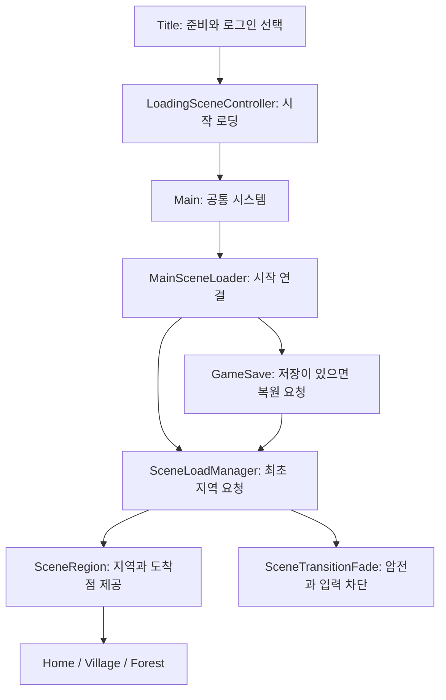
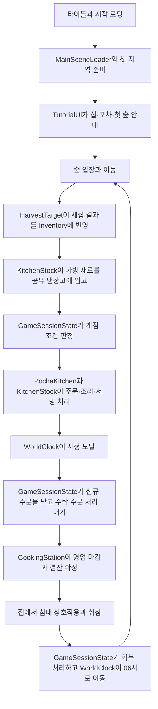

# 씬과 공통 시스템 연결

원본 Unity 프로젝트에서 사용하는 폴더·책임·호출 관계를 기록한다. 공개 저장소에는 파일별로 승인된 문서와 코드를 추출한다. 게임 실행에는 별도의 Unity 프로젝트 또는 배포 빌드가 필요하다.

## 포차 내부·마을 화면 전환 — 2026-11-18

마을은 기존 SceneRegion을 유지한다. PochaInterior를 마을 진입 후 비동기로 추가 로드하고 화면 버튼으로 카메라·오디오 리스너·플레이어 입력 대상을 전환한다. 일반 지역 전환은 이전 지역 루트를 끄고 Main 플레이어를 도착점으로 옮기는 방식이라 두 영업 공간 사이에는 사용하지 않는다. 내부는 별도 좌표에 배치하고 한 카메라·리스너만 활성화한다. 각 캐릭터 몸체는 마지막 위치를 유지하고, 입력이 없는 쪽의 모터와 물리 이동을 멈춘다. 주문·조리·마을 주민은 화면 전환 동안 진행한다. PochaKitchen은 두 화면의 재고·손·주문과 조리 상태를 소유하고, KitchenHud는 입력 선택 표시·주문 상태를 표시한다. 내부 상태와 위치는 기존 영업 스냅샷의 선택 필드에 포함한다. 예전 저장의 필드 부재는 허용하며, 개발자 검수는 새 저장에 맞춘다.

최초 씬 활성화와 반복 화면 전환을 분리해 측정한다. Galaxy S22/S26 Ultra의 30/60FPS에서 전환 입력 반응·긴 프레임·p95/p99·메모리와 두 화면 동시 영업을 확인한다. 개편 상세 (공개 제외)

## 폴더와 책임

실제 분류는 [프로젝트 폴더 구조](../Rules/Project_Structure.md)를 따른다.

| 원본 위치 | 책임 |
|---|---|
| `Assets/01_Scenes/` | Title, Main, Home, Village, Forest 지역 씬 |
| `Assets/02_Scripts/Core/` | 공통 시간·지역 전환·시작 연결과 저장 진입점 |
| `Assets/02_Scripts/UI/` | 로그인·로딩·전환 표시와 게임 HUD |
| `Assets/02_Scripts/Data/` | 저장 자료형과 파일 처리 |
| `Assets/02_Scripts/Gameplay/` | Player, Npc, Exploration, Business, Inventory, Session, World 기능 |

## 시작·지역 전환

- Title의 준비·인증 결과와 Main의 지역 준비를 구분한다. 인증과 저장의 내부 판정은 해당 담당 컴포넌트에 둔다.
- Main은 공통 시스템을 유지하고 지역 씬은 추가 로드한다. `SceneRegion`은 지역 식별과 도착점을 제공하며 전환 정책을 결정하지 않는다.
- `MainSceneLoader`는 필요한 컴포넌트를 연결하고 최초 지역/저장 복원 진입을 요청한다. 씬 전환 구현이나 저장 규칙 자체를 소유하지 않는다.
- `SceneTransitionFade`는 검은 화면·대기·입력 차단 표시를 담당한다. 게임 시간과 별개인 전환 시간을 사용한다.
- Main만 직접 실행하는 개발 흐름과 Title부터 시작하는 계정 저장 흐름을 구분한다.

## 첫 영업일의 게임 진행

2026-11-21 KST 기준. 첫 시작부터 다음 날까지 플레이어 행동과 판정을 담당하는 컴포넌트를 연결했다. 야시장은 구역 해금 이후 같은 영업 흐름에 합류한다.

| 구간 | 원본 코드와 책임 |
|---|---|
| 진입·안내 | MainSceneLoader는 시작 연결을 맡고, TutorialUi는 실제 게임 상태를 확인해 안내를 전환한다. 인증과 이어하기에서 받은 시작 조건은 기존 초기화 경로로 전달된다. [MainSceneLoader](../../Assets/02_Scripts/Core/MainSceneLoader.cs) · [TutorialUi](../../Assets/02_Scripts/UI/Tutorial/TutorialUi.cs) |
| 채집·입고 | HarvestTarget은 획득 가능 여부와 수량을 처리하고 Inventory에 반영한다. KitchenStock은 모은 재료를 공유 냉장고로 옮겨 조리에서 사용한다. [HarvestTarget](../../Assets/02_Scripts/Gameplay/Exploration/HarvestTarget.cs) · [Inventory](../../Assets/02_Scripts/Gameplay/Inventory/Inventory.cs) · [KitchenStock](../../Assets/02_Scripts/Gameplay/Business/KitchenStock.cs) |
| 주문·조리·서빙 | PochaKitchen은 플레이어 상호작용과 실내 주문을 처리한다. KitchenStock은 손에 든 재료·음식, 재료 투입과 조리 상태를 관리한다. 서빙 결과는 CookingStation에 기록된다. [PochaKitchen](../../Assets/02_Scripts/Gameplay/Business/PochaKitchen.cs) · [CookingStation](../../Assets/02_Scripts/Gameplay/Business/CookingStation.cs) |
| 마감·결산·수면 | WorldClock과 GameSessionState가 영업일과 마감 경계를 결정한다. 자정 이후 수락 주문 처리가 끝나면 CookingStation이 영업일 결산을 확정한다. 취침 완료는 GameSessionState를 통해 다음 영업일의 06:00을 준비한다. [WorldClock](../../Assets/02_Scripts/Core/Time/WorldClock.cs) · [GameSessionState](../../Assets/02_Scripts/Gameplay/Session/GameSessionState.cs) |

플레이어가 낮에 수동 마감하면 결산으로 이동하며, 취침은 밤에 할 수 있다. 기존 진행을 이어가는 경우 저장 복원 결과가 첫 지역과 진행 상태를 정한다. 최초 안내는 해당 계정의 진행 상태를 기준으로 처리한다. [튜토리얼 흐름](Tutorial_Flow.md) · [자정과 수면 검증](../Test/Logs/2026-11-20_daily-gameplay.md) · [포차 마감 검증](../Test/Logs/2026-11-21_pocha-close-and-outdoor-queue.md)

## 원본 코드

- [MainSceneLoader](../../Assets/02_Scripts/Core/MainSceneLoader.cs): 시작 연결과 저장 복원 진입 요청.
- [SceneRegion](../../Assets/02_Scripts/Core/SceneRegion.cs): 지역 루트와 도착점 조회.
- [SceneTransitionFade](../../Assets/02_Scripts/UI/SceneTransitionFade.cs): 전환 표시와 입력 차단.

위 링크는 비공개 원본에서 실제 파일을 가리키며 공개 추출에서는 대응하는 원본 `Assets/` 경로로 연결된다. 원본 C#을 공개용으로 다시 작성하거나 내부 구현을 빈 코드로 바꾸지 않는다. 위 시작 연결 코드 3개와 첫 영업일의 게임플레이 코드 8개는 각 메서드의 호출과 책임을 읽는 자료다. 인증·저장, 씬 전환 정책, 콘텐츠 정의와 Unity 참조 에셋은 비공개 구현에 의존하므로 독립 컴파일·실행에는 별도 프로젝트 구성이 필요하다.

## 공개 범위와 검증

저장·활성 기기 세션의 핵심 구현, 인증 설정, SDK·외부 에셋·씬/프리팹·빌드 파일은 공개하지 않는다. 폴더와 호출 관계의 설명이 해당 내부 구현의 공개를 의미하지 않는다. 개발자 판단·개발자 직접 설정/빌드/실기기 검사·AI 코드와 기록 작업은 [협업 기록](../Workflow/Collaboration_Log.md) 및 검수한 GitHub Issues에 구분해 남긴다.

검증 결과는 [기술 기준선](Technical_Baseline.md)의 실제 범위를 따른다. 구조 설명과 공개 코드 추출은 새 Android 실행·성능·전체 보안 검증 결과가 아니다.

2026-11-15 개발자 지시: 공개 파일은 별도 Source 디렉터리로 재배치하지 않고 원본 Assets 상대 경로에 둔다. Assets 전체 실제 하위 디렉터리는 공개하며, 공개 파일이 없는 말단 폴더는 내용이 빈 .gitkeep으로 보존한다. 이는 디렉터리 표시만 허용하며 핵심 코드·인증 설정·SDK·외부 에셋·씬/프리팹·meta 내용의 공개를 허용하지 않는다. .public-sync는 동기화 상태 관리에 필요해 유지한다. 과거 Source 경로는 승인 이력 검증만 지원하고 현재 공개 파일은 원본 경로로 이동한다.
