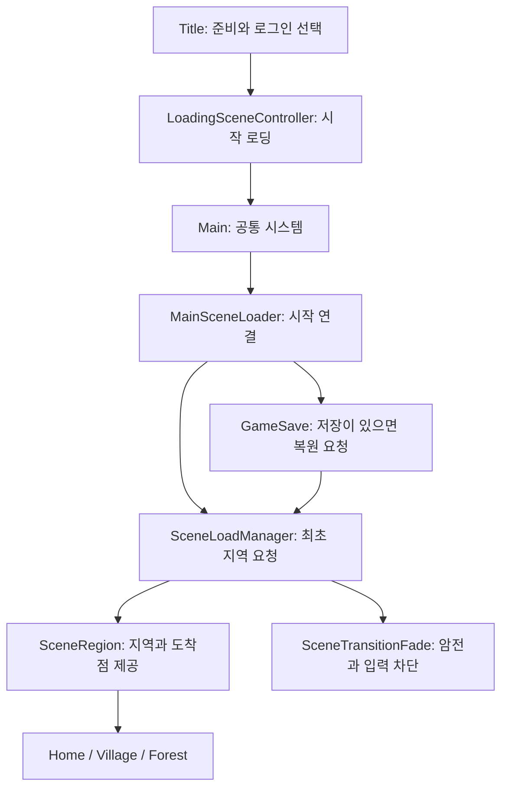

# 씬과 공통 시스템 연결

2026-11-14 기준. 원본 Unity 프로젝트에서 사용하는 폴더·책임·호출 관계를 기록한다. 공개 저장소에는 이 문서와 승인한 연결 코드만 추출하며, 실행 가능한 Unity 프로젝트 전체를 제공하지 않는다.

## 폴더와 책임

실제 분류는 [프로젝트 폴더 구조](../Rules/Project_Structure.md)를 따른다.

| 원본 위치 | 책임 |
|---|---|
| `Assets/01_Scenes/` | Title, Main, Home, Village, Forest 지역 씬 |
| `Assets/02_Scripts/Core/` | 공통 시간·지역 전환·시작 연결과 저장 진입점 |
| `Assets/02_Scripts/UI/` | 로그인·로딩·전환 표시와 게임 HUD |
| `Assets/02_Scripts/Data/` | 저장 자료형과 파일 처리 |
| `Assets/02_Scripts/Gameplay/` | Player, Npc, Exploration, Business, Inventory, Session, World 기능 |

## 시작·지역 전환

- Title의 준비·인증 결과와 Main의 지역 준비를 구분한다. 인증과 저장의 내부 판정은 해당 담당 컴포넌트에 둔다.
- Main은 공통 시스템을 유지하고 지역 씬은 추가 로드한다. `SceneRegion`은 지역 식별과 도착점을 제공하며 전환 정책을 결정하지 않는다.
- `MainSceneLoader`는 필요한 컴포넌트를 연결하고 최초 지역/저장 복원 진입을 요청한다. 씬 전환 구현이나 저장 규칙 자체를 소유하지 않는다.
- `SceneTransitionFade`는 검은 화면·대기·입력 차단 표시를 담당한다. 게임 시간과 별개인 전환 시간을 사용한다.
- Main만 직접 실행하는 개발 흐름과 Title부터 시작하는 계정 저장 흐름을 구분한다.

## 원본 코드

- [MainSceneLoader](../../Source/Core/MainSceneLoader.cs): 시작 연결과 저장 복원 진입 요청.
- [SceneRegion](../../Source/Core/SceneRegion.cs): 지역 루트와 도착점 조회.
- [SceneTransitionFade](../../Source/UI/SceneTransitionFade.cs): 전환 표시와 입력 차단.

위 링크는 비공개 원본에서 실제 파일을 가리키며 공개 추출에서는 대응하는 `Source/` 경로로 연결된다. 원본 C#을 공개용으로 다시 작성하거나 내부 구현을 빈 코드로 바꾸지 않는다. 참조하는 일부 타입의 구현은 공개 대상 밖이므로 이 세 파일만으로 독립 컴파일·실행할 수 있다는 의미는 아니다.

## 공개 범위와 검증

저장·활성 기기 세션의 핵심 구현, 인증 설정, SDK·외부 에셋·씬/프리팹·빌드 파일은 공개하지 않는다. 폴더와 호출 관계의 설명이 해당 내부 구현의 공개를 의미하지 않는다. 개발자 판단·개발자 직접 설정/빌드/실기기 검사·AI 코드와 기록 작업은 [협업 기록](../Workflow/Collaboration_Log.md) 및 검수한 GitHub Issues에 구분해 남긴다.

검증 결과는 [기술 기준선](Technical_Baseline.md)의 실제 범위를 따른다. 구조 설명과 공개 코드 추출은 새 Android 실행·성능·전체 보안 검증 결과가 아니다.
